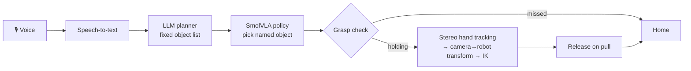

# SO-101 Voice Handover Assistant

> "Hand me the red marker." — the arm finds it, picks it up, tracks your hand in 3D, and places it in your palm.

A voice-commanded robotic assistant built on a self-assembled [SO-101](https://github.com/TheRobotStudio/SO-ARM100) arm. It combines a **fine-tuned vision-language-action policy** for grasping with **classical stereo hand tracking and inverse kinematics** for human handover.

**Status:** 🚧 In development — see [Roadmap](#roadmap). Results below are filled in as milestones land.

<!-- Replace with demo video/GIF once Milestone 4 is complete -->
<!--  -->

---

## How it works



| Stage | Method | Why |
|---|---|---|
| Speech → task | STT + LLM tool call constrained to a fixed object list | Prevents requests the policy wasn't trained for |
| Pick | **SmolVLA** (450M-param VLA, fine-tuned from `lerobot/smolvla_base`); **ACT** as baseline | Learned policies handle varied object poses well |
| Handover | **Classical**: 3D hand keypoint → `T_base_cam` → IK → velocity-capped approach | Hand position varies continuously; classical control is safer and predictable near a person |
| Release | Gripper load change when the user pulls | No extra sensors |
| Orchestration | State machine: `IDLE → LISTEN → PLAN → PICK → CHECK → PRESENT → RELEASE → HOME` | Every state has a timeout and a safe fallback |

**Design choice:** learning where it helps (grasping cluttered, variable scenes), model-based control where precision and safety matter (moving toward a human).

---

## Hardware

| Component | Details |
|---|---|
| Follower arm | SO-101, 6× Feetech STS3215 (1/345), 5-DOF + gripper |
| Leader arm | SO-101 leader (mixed gear ratios) for teleoperated data collection |
| Policy cameras | 2× RGB USB webcams — fixed front view + wrist-mounted |
| Hand tracking | Stereo camera pair, YOLOv8-pose + triangulation |
| Compute | GPU machine for policy inference; cloud GPU for training |
| Safety | Inline hardware kill switch on servo power |

---

## Results

_To be filled in with measured numbers. Format:_

| Metric | Value | Trials |
|---|---|---|
| Pick success — SmolVLA | TBD | n = 20 |
| Pick success — ACT | TBD | n = 20 |
| Handover success | TBD | n = 20 |
| End-to-end success (voice → handover) | TBD | n = 20 |
| Median command-to-handover latency | TBD | — |
| Camera→robot calibration error (RMS) | TBD | — |

**Data scaling (SmolVLA pick success):**

| Demos per object | 25 | 50 | 100 |
|---|---|---|---|
| Success | TBD | TBD | TBD |

---

## Setup

```bash
git clone <this-repo>
cd <this-repo>

# LeRobot with Feetech + SmolVLA support (see LeRobot installation guide)
pip install -e ".[feetech]"
pip install -e ".[smolvla]"
```

Arm bring-up follows the [LeRobot SO-101 guide](https://huggingface.co/docs/lerobot/so101):

```bash
lerobot-find-port
lerobot-setup-motors --robot.type=so101_follower --robot.port=<port>
lerobot-calibrate   --robot.type=so101_follower --robot.port=<port> --robot.id=<name>
```

Project configuration (ports, camera indices, calibration paths, thresholds) lives in `config/` — copy the example file and edit for your setup.

---

## Usage

<!-- Fill in once entry points exist -->

```bash
# Record demonstrations (per object)
lerobot-record ... --dataset.single_task="pick up the red marker"

# Train
lerobot-train --policy.path=lerobot/smolvla_base --dataset.repo_id=<user>/<dataset> ...

# Run the full assistant
python -m assistant.main --config config/<your-config>.yaml
```

---

## Safety

This arm moves toward a person. The system enforces:

- Hardware kill switch on servo power
- Velocity caps during approach and release
- Workspace bounds (never above shoulder height or toward the face)
- Gripper torque limit
- Abort if hand tracking is lost

Do not run handover without the kill switch within reach.

---

## Roadmap

- [ ] **M0** Follower bring-up and calibration
- [ ] **M1** Leader arm build, teleoperation with cameras
- [ ] **M2** SmolVLA + ACT pick a named object
- [ ] **M3** Classical handover to tracked hand
- [ ] **M4** Full voice → pick → handover loop
- [ ] **M5** Evaluation: SmolVLA vs ACT, data scaling, end-to-end metrics

---

## Repository layout

```
assistant/       state machine, voice, planner, handover controller
calibration/     camera intrinsics, stereo, camera→robot
config/          per-setup configuration
docs/            frames.md, design notes, media
scripts/         data collection and evaluation helpers
```

---

## Acknowledgements

- [LeRobot](https://github.com/huggingface/lerobot) — robot drivers, data collection, training, and rollout tooling
- [SmolVLA](https://huggingface.co/docs/lerobot/smolvla) — pretrained vision-language-action base model
- [SO-ARM100 / SO-101](https://github.com/TheRobotStudio/SO-ARM100) — open-source arm design by TheRobotStudio
- ACT (Action Chunking with Transformers) — baseline policy

## Author

Jerry Liu — Mechatronics Engineering, University of Waterloo
[GitHub](https://github.com/j3rry1iu) · [LinkedIn](https://linkedin.com/in/jerry-liu-uw/)
